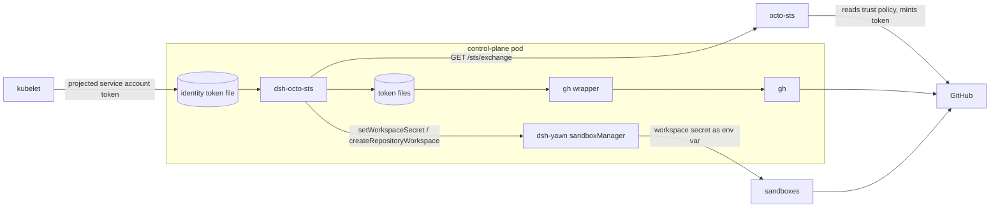
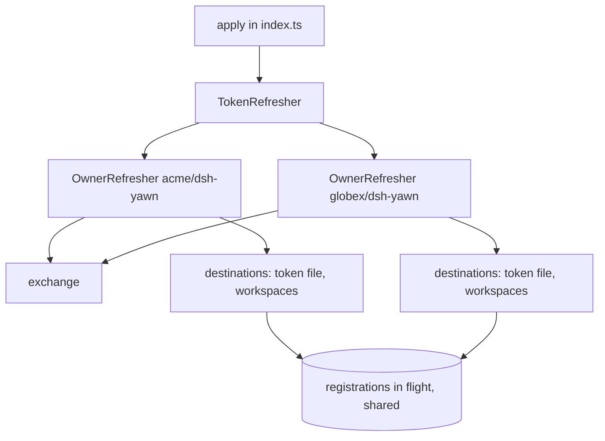
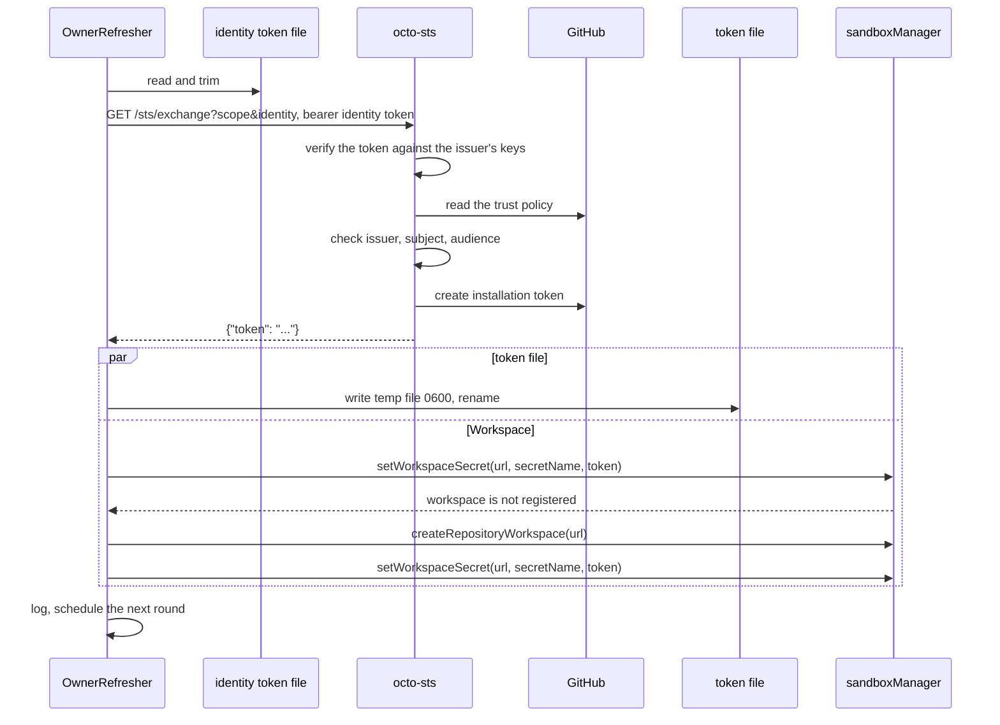

# Architecture

dsh-octo-sts is a small Cordis plugin. It has no server, no state on disk besides the token files, and no dependency other than zod.

## Context

- **kubelet** mounts and rotates the projected service account token.
- **octo-sts** checks that token against the trust policy in GitHub and returns an installation token.
- **dsh-yawn's `sandboxManager`** stores workspace secrets. Handing them to sandbox commands is dsh-yawn's job, not the plugin's.
- **The gh wrapper** reads a token file per `gh` call. See the README.

## Source layout

| File | Role |
| --- | --- |
| [`src/index.ts`](../src/index.ts) | Plugin entry: `name`, `inject`, `Config` and `apply`. Starts a `TokenRefresher` in a Cordis effect and stops it on dispose. Re-exports the public helpers |
| [`src/config.ts`](../src/config.ts) | Configuration schema and validation. `ownerSettings` turns either form into a list of owners |
| [`src/exchange.ts`](../src/exchange.ts) | One call to octo-sts: request, timeout and answer parsing |
| [`src/refresher.ts`](../src/refresher.ts) | The refresh loop per owner, destinations, workspace registration, backoff, logging and the token file writer |
| [`examples/gh-owner-token.sh`](../examples/gh-owner-token.sh) | The multi-owner gh wrapper |
| [`cordis.patch.yml`](../cordis.patch.yml) | Bundle layer that inserts the plugin row disabled |

`inject` is empty. The plugin looks up `sandboxManager` with `ctx.get('sandboxManager')` on every workspace write, so it starts even before dsh-yawn's sandbox manager is up, and the token file still gets the token.

## Components

- `TokenRefresher` creates one `OwnerRefresher` per owner and starts and stops them together.
- `OwnerRefresher` holds the owner's current token, when it was issued, when the next exchange is due, the last exchange failure, the delivery state of each destination and the failure counts.
- Registrations in flight are kept in a map keyed by the exact workspace URL. A registration that outlives its 5 minute limit stays in the map until it settles, so the next round waits for it instead of starting another.

## Token flow

One round of one owner, with a token file and one Workspace that is not registered yet:

The steps on the octo-sts side are simplified octo-sts behaviour, shown for context. See [trust-policies.md](trust-policies.md#how-the-pieces-fit) for the order of its checks.

### Exchange

[`exchange`](../src/exchange.ts) sends `GET <sts>/sts/exchange` with the query parameters `scope` and `identity` and the headers `Authorization: Bearer <identity token>` and `Accept: application/json`. It refuses redirects and gives up after 30 seconds (`octo-sts did not answer within 30 s`).

- A `2xx` answer must be JSON with a non-empty `token` string. Anything else fails with `octo-sts answered without a token`.
- A non-`2xx` answer fails with `octo-sts answered <status>: <reason>`. The reason is the `message` field of a JSON body, or else the HTTP status text, or `no reason given` when both are missing or empty.
- When the request itself fails, the error names the network cause: the cause's `code`, or else its message, as in `fetch failed: ECONNREFUSED`.
- Error texts are cleaned before they are logged. The identity token is replaced with `[redacted]`, and control, format and line or paragraph separator characters become spaces. The reason is then cut to 200 code points, so no part of a long echoed identity token survives the cut.
- On a `429`, the `Retry-After` header is read as seconds or an HTTP date, and capped at one hour.

### Delivery

Every destination of an owner is written at the same time. A slow or hung destination does not hold up the others.

- A destination is skipped when it still holds the current token (see [Repair](#repair)).
- No destination gets a token that is one hour old or older, counted from the moment the exchange started.
- A Workspace write calls `setWorkspaceSecret` and gives up after 60 seconds. The token file write has no timeout.
- When dsh-yawn answers `workspace is not registered` and `registerWorkspaces` is on, the plugin calls `createRepositoryWorkspace`, then sets the secret again.
- Registration has a 5 minute limit. Only one registration per Workspace runs at a time; a second caller waits for the first instead of starting another.

### Repair

Between exchanges, a check runs at least once a minute while the plugin is not backing off. It asks each destination that received the current token whether it still holds it:

- **Token file:** the file still exists. Only its existence is checked, not its content.
- **Workspace:** `ctx.get('sandboxManager')` still returns the same sandboxManager instance that received the secret. Cordis hands out a new proxy on every lookup, so the plugin compares the object behind the proxy (`Symbol.for('cordis.original')`).

A destination that lost the token gets the current token again, without a new exchange. The plugin logs `token delivered again to <destinations>, which had lost it`. A destination whose last write failed is not checked this way; it is retried as a failure (see [Failure handling](#failure-handling)). Repair keeps running while octo-sts refuses the exchange, as long as the current token is younger than one hour.

### Scheduling

- The first round runs right after start and exchanges at once.
- After a failed exchange, the exchange is retried at the next round, except after a refusal (see [Failure handling](#failure-handling)).
- After a successful exchange, the next exchange is due `refreshMinutes` after that exchange started. A slow answer does not push it back.
- Between exchanges, rounds run at least once a minute for the [repair](#repair) check, except while backing off. A round with nothing to do logs nothing.
- Time comes from `performance.now()`, a monotonic clock. A wall-clock change does not trigger or delay an exchange.
- Timers are unreferenced, so they never keep the process alive.

## Failure handling

Nothing is ever removed or overwritten with an empty value. Every destination keeps its last token until its hour is up.

| Failure | Kind | Next attempt |
| --- | --- | --- |
| Identity token file missing or empty | transient | backoff |
| Network error, 30 s timeout, `5xx`, `408` or an answer without a token | transient | backoff |
| `429` | transient | backoff, but at least `Retry-After`, at most `refreshMinutes` |
| Any other `4xx` | refused | `refreshMinutes` later, without backoff |
| `sandboxManager` not available | transient | backoff, this Workspace only |
| `setWorkspaceSecret` error or timeout | transient | backoff, this destination only |
| Token file write error | transient | backoff, this destination only |
| Registration error or timeout | transient | backoff, this Workspace only |
| `workspace is not registered` with `registerWorkspaces: false` | permanent | next exchange |
| `workspace is not registered` again right after registering | permanent | next exchange |
| Registration needs the dsh Web profile | permanent | next exchange |
| `sandboxManager` has no `createRepositoryWorkspace` | permanent | next exchange |
| The round itself throws | unexpected | backoff, logged as `refresh failed: <error>` |

- **Backoff** is 1, 2 and 4 minutes, then every 5 minutes, counted per owner. A transient destination failure retries the same token without a new exchange.
- **Refused** exchanges are not retried sooner, because the same request would be refused again. While the refusal lasts, failed destinations are retried at the one-minute check instead of on the backoff.
- **Permanent** destination failures are skipped until a new token is issued. They do not cause a backoff.
- When nothing failed, the next round is the one-minute check, or the next exchange if that is sooner.

## Logs

Every line starts with `dsh-octo-sts: <scope>/<identity>`.

| Level | Text after the prefix | When |
| --- | --- | --- |
| info | `token delivered to every destination; next exchange in <N> min` | A fresh token reached every destination, or every failed destination recovered |
| info | `token delivered to every destination after <N> failed exchange(s); next exchange in <N> min` | The first full delivery after failed exchanges. Only exchange attempts are counted, not repair or retry rounds |
| info | `token delivered again to <destinations>, which had lost it` | The [repair](#repair) check redelivered the token |
| warn | `<problems>; destinations keep their last token until it expires; next attempt in <N> s` | The exchange or a destination failed, but a destination holds a token younger than one hour |
| error | `<problems>; no destination holds a valid token; next attempt in <N> s` | The same, and no destination holds such a token |
| error | `refresh failed: <error>; next attempt in <N> s` | The round threw |

`<problems>` lists `exchange failed: <error>` and each failed destination as `<destination>: <error>`, or `<destination> (retried at the next exchange): <error>` for a permanent failure. They are joined with `; `.

While an exchange is refused (a `4xx` other than `408` and `429`), the same warn or error line is logged once, not every round. It is logged again when its text or level changes.

Exchange errors have the identity token replaced with `[redacted]`; destination errors and `refresh failed` lines have the GitHub token replaced. A logger that throws is ignored.

## Lifecycle and errors

- `apply` registers a Cordis effect labelled `octo-sts: token refresh`. Disposing it calls `stop`.
- `stop` aborts the exchange in flight, clears the timer and waits for the running round. Workspace writes and registrations in flight are abandoned at once, so `stop` returns promptly even when the sandboxManager hangs. A token from an aborted exchange is not delivered.
- Every error stays inside the loop: a round that throws is logged and rescheduled, never left as a rejected promise (covered by the tests). Node.js ends the process on an unhandled rejection by default, which would take dsh down with it.

## Public exports

Besides the plugin fields, `src/index.ts` exports `OctoStsConfigSchema`, `ownerSettings`, `exchange`, `TokenRefresher`, `PermanentError`, `readIdentityToken`, `removeTemporaryFiles`, `retryDelayMs`, `writeTokenFile` and the types `OctoStsConfig`, `OwnerSettings` and `SecretStore`. The package is at version 0.1.0, so expect them to change.
