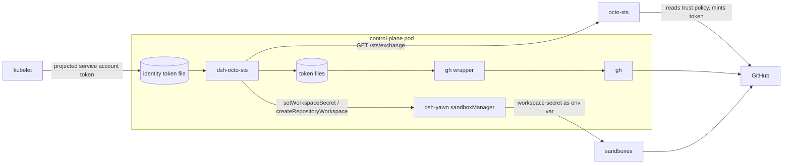
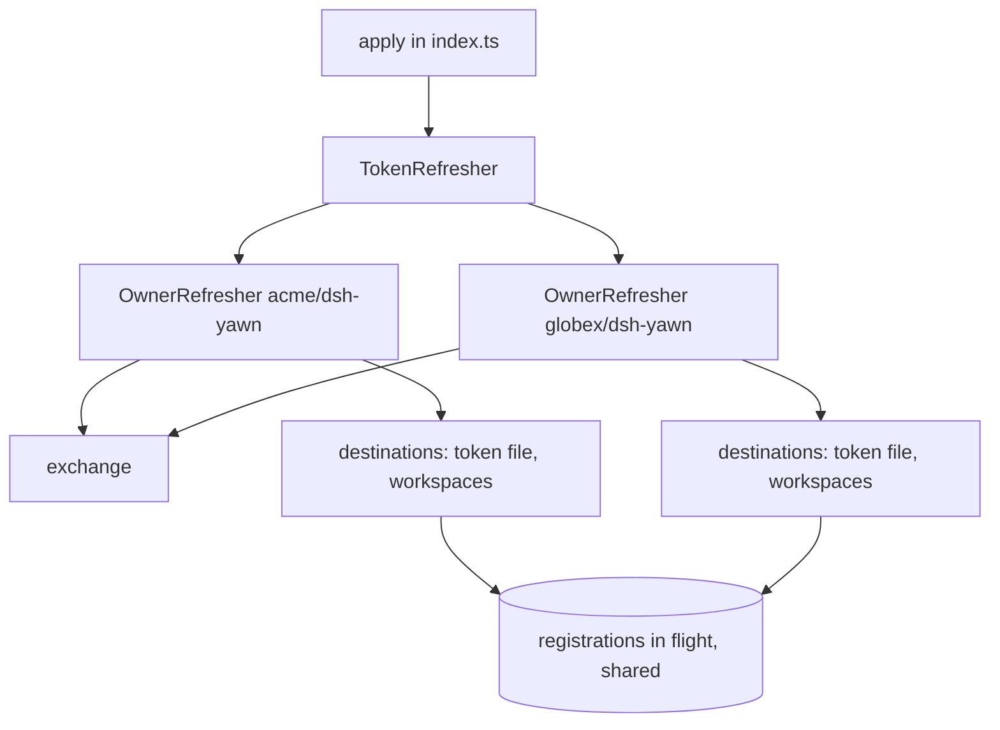
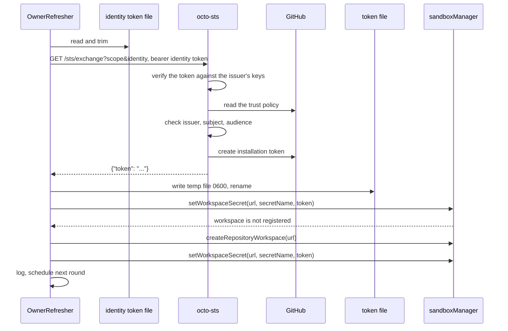

# Architecture

dsh-octo-sts is a small Cordis plugin. It has no server, no state on disk besides the token files, and no dependency other than zod.

## Context

- **kubelet** mounts and rotates the projected service account token.
- **octo-sts** checks that token against the trust policy in GitHub and returns an installation token.
- **dsh-yawn's `sandboxManager`** stores workspace secrets. Handing them to sandbox commands is dsh-yawn's job, not the plugin's.
- **The gh wrapper** reads a token file per `gh` call. See the README.

## Source layout

| File | Role |
| --- | --- |
| [`src/index.ts`](../src/index.ts) | Plugin entry: `name`, `inject`, `Config` and `apply`. Starts a `TokenRefresher` in a Cordis effect and stops it on dispose. Re-exports the public helpers |
| [`src/config.ts`](../src/config.ts) | Configuration schema and validation. `ownerSettings` turns either form into a list of owners |
| [`src/exchange.ts`](../src/exchange.ts) | One call to octo-sts: request, timeout and answer parsing |
| [`src/refresher.ts`](../src/refresher.ts) | The refresh loop per owner, destinations, workspace registration, backoff, logging and the token file writer |
| [`examples/gh-owner-token.sh`](../examples/gh-owner-token.sh) | The multi-owner gh wrapper |
| [`cordis.patch.yml`](../cordis.patch.yml) | Bundle layer that inserts the plugin row disabled |

`inject` is empty. The plugin looks up `sandboxManager` with `ctx.get('sandboxManager')` on every workspace write, so it starts even before dsh-yawn's sandbox manager is up, and the token file still gets the token.

## Components

- `TokenRefresher` creates one `OwnerRefresher` per owner and starts and stops them together.
- `OwnerRefresher` holds the owner's current token, the time it was issued, the delivery state of each destination and the failure count.
- Registrations in flight are kept in a map keyed by the exact workspace URL. A registration that outlives its 5 minute limit stays in the map until it settles, so the next round waits for it instead of starting another.

## Token flow

One round of one owner, with a token file and one Workspace that is not registered yet:

The steps on the octo-sts side are simplified octo-sts behaviour, shown for context. See [trust-policies.md](trust-policies.md#how-the-pieces-fit) for the order of its checks.

### Exchange

[`exchange`](../src/exchange.ts) sends `GET <sts>/sts/exchange` with the query parameters `scope` and `identity` and the headers `Authorization: Bearer <identity token>` and `Accept: application/json`. It refuses redirects and gives up after 30 seconds.

- A `2xx` answer must be JSON with a non-empty `token` string. Anything else fails with `octo-sts answered without a token`.
- A non-`2xx` answer fails with `octo-sts answered <status>: <reason>`. The reason is the `message` field of a JSON body, cut to 200 characters. Without a JSON body or a `message` field, it is the HTTP status text, or `no reason given` when that is empty.

### Delivery

Destinations are written one after another, the token file first, then each Workspace in list order.

- A destination that already holds the current token is skipped.
- A Workspace write calls `setWorkspaceSecret` and gives up after 60 seconds. The token file write has no timeout.
- When dsh-yawn answers `workspace is not registered` and `registerWorkspaces` is on, the plugin calls `createRepositoryWorkspace`, then sets the secret again.
- Registration has a 5 minute limit. Only one registration per Workspace runs at a time; a second caller waits for the first instead of starting another.

### Scheduling

- The first round runs right after start.
- Each round exchanges only when the owner has no token yet or the current one is at least `refreshMinutes` old. Otherwise it only retries failed destinations.
- The issuance time is taken before the request. The next exchange is due `refreshMinutes` after that.
- Time comes from `performance.now()`, a monotonic clock. A wall-clock change does not trigger or delay an exchange.
- Timers are unreferenced, so they never keep the process alive.

## Failure handling

Nothing is ever removed or overwritten with an empty value. Every destination keeps its last token until its hour is up.

| Failure | Kind | Next attempt |
| --- | --- | --- |
| Identity token file missing or empty | transient | backoff |
| Exchange refused, timed out or without a token | transient | backoff |
| `sandboxManager` not available | transient | backoff, this Workspace only |
| `setWorkspaceSecret` error or timeout | transient | backoff, this destination only |
| Token file write error | transient | backoff, this destination only |
| Registration error or timeout | transient | backoff, this Workspace only |
| `workspace is not registered` with `registerWorkspaces: false` | permanent | next exchange |
| `workspace is not registered` again right after registering | permanent | next exchange |
| Registration needs the dsh Web profile | permanent | next exchange |
| `sandboxManager` has no `createRepositoryWorkspace` | permanent | next exchange |

- **Backoff** is 1, 2 and 4 minutes, then every 5 minutes, counted per owner. A transient destination failure retries the same token without a new exchange.
- **Permanent** failures are skipped until a new token is issued. They do not cause a backoff.
- When nothing transient failed, the next round runs when the next exchange is due.

## Logs

One line per round at most, prefixed `dsh-octo-sts: <scope>/<identity>`.

- **info** after a fresh token reached every destination, or after recovering from failures (`after N failed attempts`). A quiet round logs nothing.
- **warn** when the exchange or a destination failed but at least one destination holds a token younger than one hour.
- **error** when no destination holds such a token.

Failure lines list each problem and the delay until the next attempt. Exchange errors have the identity token replaced with `[redacted]`; destination errors have the GitHub token replaced. A logger that throws is ignored.

## Lifecycle and errors

- `apply` registers a Cordis effect labelled `octo-sts: token refresh`. Disposing it calls `stop`.
- `stop` aborts the exchange in flight, clears the timer and waits for the running round. A token from an aborted round is not delivered.
- Every error stays inside the loop: a round never rejects, even when every dependency throws (covered by the tests). Node.js ends the process on an unhandled rejection by default, which would take dsh down with it.

## Public exports

Besides the plugin fields, `src/index.ts` exports `OctoStsConfigSchema`, `ownerSettings`, `exchange`, `TokenRefresher`, `PermanentError`, `readIdentityToken`, `removeTemporaryFiles`, `retryDelayMs`, `writeTokenFile` and the types `OctoStsConfig`, `OwnerSettings` and `SecretStore`. The package is at version 0.1.0, so expect them to change.
